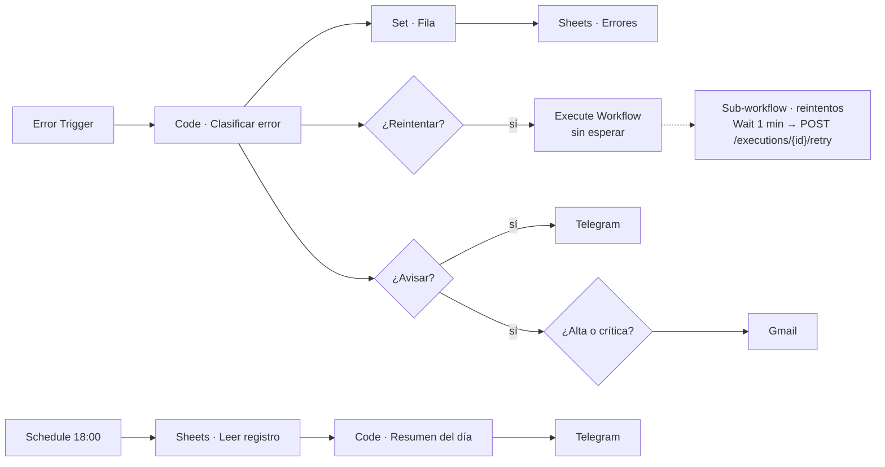

# Guía técnica: monitor central de errores

Cómo ponerlo en producción, cómo ajustar las reglas y qué límites tiene.
Para probarlo rápido basta el [README](README.md).

---

## 1. Arquitectura



| Nodo | Qué hace |
| --- | --- |
| **Clasificar error** | Lee el aviso, lo limpia, lo clasifica, lo agrupa en un incidente y devuelve `reintentar` (sí/no), `aviso` (`alerta`, `escalado`, `recordatorio` o vacío), la severidad, el mensaje y la fila del registro. |
| **¿Reintentar?** / **¿Avisar?** | Dos decisiones independientes. Un error pasajero que se repite mucho se reintenta y además se escala. |
| **Pedir reintento (sin esperar)** | *Execute Workflow* con *Wait for Sub-Workflow Completion* desactivado. Ver la sección 5. |
| **Sub-workflow de reintentos** | Espera 1 minuto y llama a `POST /api/v1/executions/{id}/retry`. Si la API falla, avisa por Telegram. |

La memoria de incidentes y de cadenas de reintento vive en `workflowStaticData`
del monitor. El historial completo queda en la hoja.

---

## 2. Puesta en producción

### 2.1 Importar y activar

1. Importa `workflows/monitor_reintentos.json` y `workflows/monitor_produccion.json`.
2. **Activa los dos.** En n8n 2.x, un Error Workflow y un sub-workflow que no
   están activos no se ejecutan (ver sección 5).
3. En cada workflow que quieras vigilar: **Settings → Error Workflow →
   Monitor de errores · producción**.

### 2.2 API de n8n (para reintentar)

1. En n8n: **Settings → n8n API → Create an API key**, con el permiso
   `execution:retry`.
2. Crea una credencial **Header Auth**: nombre `X-N8N-API-KEY`, valor la clave.
3. En el nodo **n8n · Reintentar ejecución** reemplaza `REEMPLAZAR_URL_N8N` por
   la URL de tu instancia (por ejemplo `https://n8n.empresa.pe`) y asigna la credencial.

### 2.3 Canales y registro

| Nodo | Qué reemplazar |
| --- | --- |
| Telegram (3 nodos) | `REEMPLAZAR_CHAT_EQUIPO` y la credencial del bot |
| Gmail · Aviso al responsable | `REEMPLAZAR_CORREO_RESPONSABLE` |
| Sheets (2 nodos) | `REEMPLAZAR_ID_HOJA`; pestaña `Errores` con las columnas de abajo |

```
fecha | workflow | nodo | categoria | severidad | accion | mensaje | codigo | ejecucion | reintento | reintentado | huella
```

---

## 3. Ajustar las reglas

En `src/monitor.py` y `workflows/src/monitor.js` (el test de paridad avisa si
quedan distintos):

| Constante | Valor | Significado |
| --- | --- | --- |
| `PAUSA_CIERRE` | 30 min | Sin repetirse este tiempo, el incidente se cierra |
| `UMBRAL_ESCALAR` | 5 | Repeticiones para escalar |
| `RECORDATORIO` | 4 h | Cada cuánto se recuerda un incidente abierto |
| `MAX_REINTENTOS` | 2 | Reintentos automáticos por ejecución original |
| `CRITICOS` | cobros, stock | Workflows que suben un nivel de severidad |
| `SIN_REINTENTO` | envío masivo | Workflows que nunca se reintentan solos |
| `CATEGORIAS` | — | Frases y códigos HTTP de cada tipo de error |

Después: `python scripts/build_workflow.py` y vuelve a importar.

### Cómo se reconoce "el mismo error"

La huella combina el workflow, el nodo y el mensaje sin lo que cambia en cada
ejecución: números, URLs, correos, UUID y textos entre comillas. Así,
`Pedido 123 falló en https://api/a` y `Pedido 987 falló en https://api/b` son
el mismo incidente.

---

## 4. Límites conocidos

- **Un reintento repite la ejecución entera.** Si el workflow ya había hecho
  algo antes del nodo que falló (por ejemplo, enviar un correo), lo vuelve a
  hacer. Por eso solo se reintentan errores pasajeros, y los workflows con
  efectos que no deben repetirse se agregan a `SIN_REINTENTO`: en esos, el
  monitor avisa en vez de reintentar.
- **Reintentos hechos a mano.** Si alguien reintenta desde la interfaz y
  vuelve a fallar, el monitor no conoce el origen: avisa y no reintenta más.
  Es intencional.
- **Errores que ocurren a la vez.** Dos errores que llegan en el mismo
  instante leen la memoria antes de que el otro la guarde. En el peor caso,
  se envía un aviso de más; nunca se pierde un error, porque cada uno queda
  en el registro.
- **El resumen diario lee toda la hoja.** Con meses de historial conviene
  archivar la pestaña cada cierto tiempo.

---

## 5. Comportamientos de n8n encontrados al probar

- **El reintento por API corre mientras quien lo pidió sigue esperando.** En
  las pruebas, `POST /executions/{id}/retry` respondió recién cuando el
  reintento terminó.
  Si falla, n8n ejecuta el Error Workflow de nuevo **antes** de que termine la
  ejecución que pidió el reintento, y esa nueva ejecución lee una memoria sin
  actualizar. Con la primera versión, el contador de reintentos no pasaba de 1
  y los reintentos seguían sin fin (se detuvo a mano en la prueba). Por eso el
  reintento va en un sub-workflow llamado sin esperar respuesta, y por eso
  existe la regla de "origen desconocido = no reintentar".
- **El Error Workflow y los sub-workflows deben estar activos** en n8n 2.x.
  Si no, el registro muestra `Workflow "…" is not active and cannot be
  executed` y el error se pierde sin aviso.
- **El aviso incluye datos sensibles.** `execution.error.node.parameters` y
  `execution.error.context.request` traen la URL, las cabeceras y los
  parámetros del nodo que falló. El monitor no los copia.
- **`workflowStaticData` sí se guarda en ejecuciones del Error Trigger** (se
  verificó con varios errores seguidos), pero solo al terminar la ejecución.
