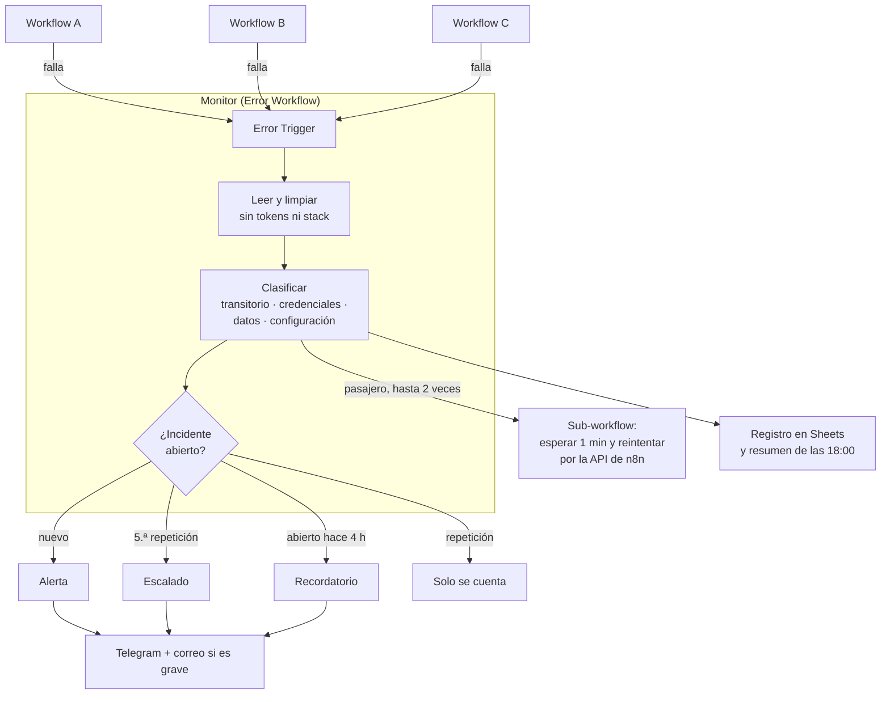
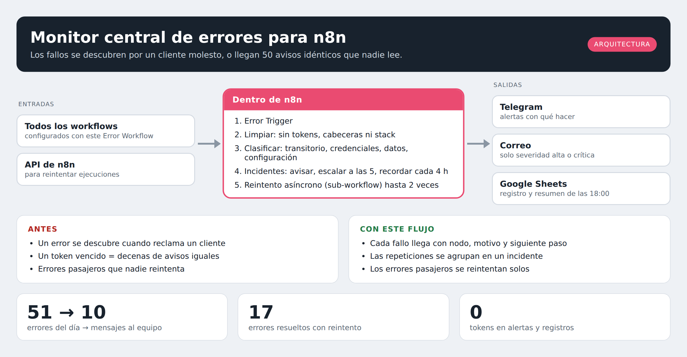
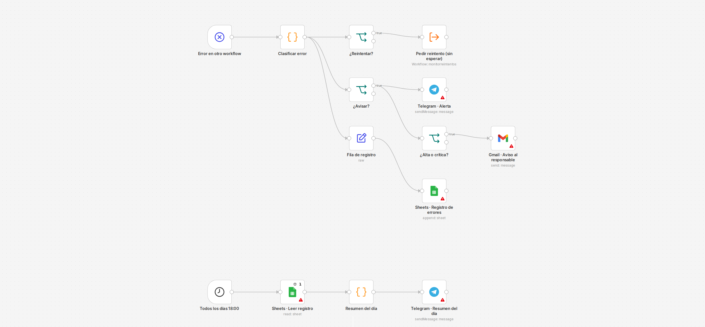
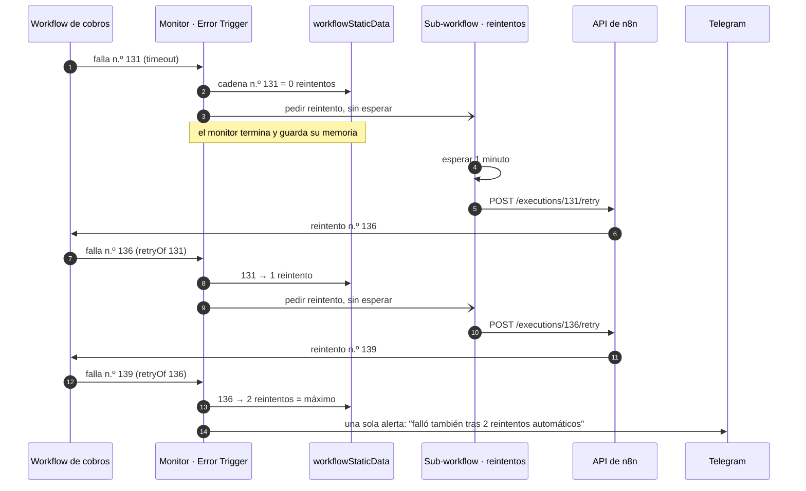
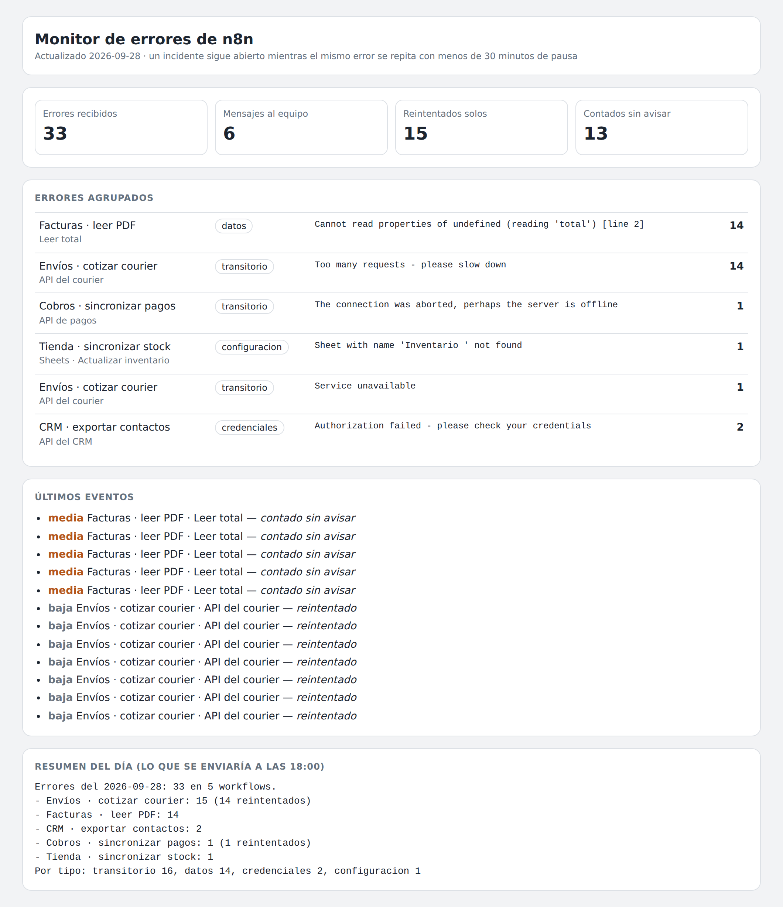
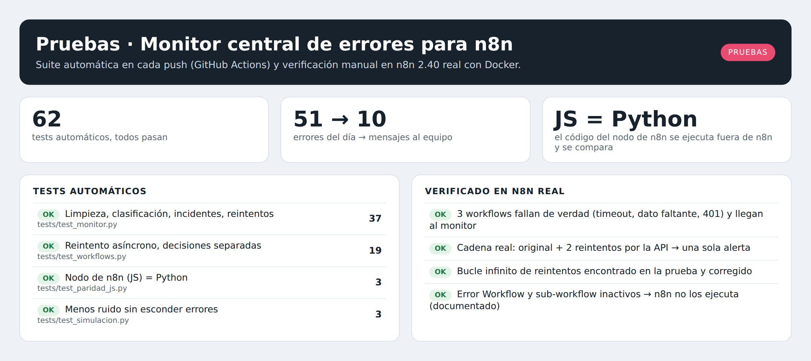
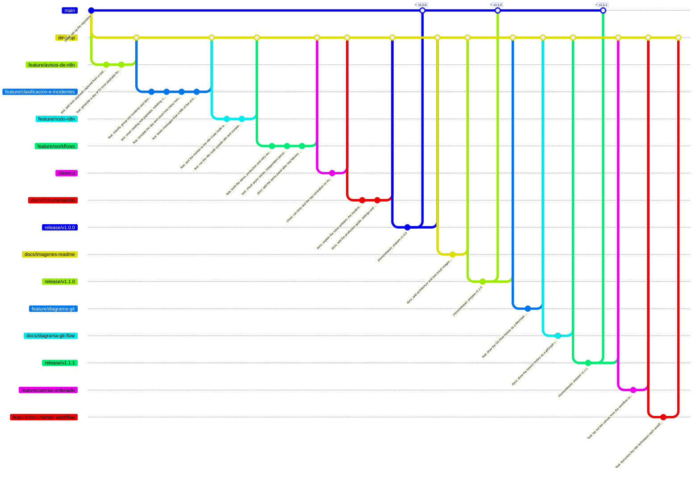

<h1 align="center">Monitor central de errores para n8n</h1>

<p align="center"><i>51 errores en un día, 10 mensajes al equipo, y ninguno sin explicar qué hacer</i></p>

<p align="center">
  
  
  
  
  
</p>

---

## Para qué existe este repositorio

Una empresa con veinte workflows en n8n se entera de que uno falló cuando un cliente reclama. Si activa los avisos, pasa lo contrario: un token vencido hace fallar el mismo workflow cada 10 minutos y llegan 50 correos idénticos, hasta que nadie los lee. Y buena parte de los errores son pasajeros (una API que tardó o limitó las peticiones) y se habrían resuelto reintentando.

**Este workflow recibe el error de cualquier otro workflow, lo clasifica, lo reintenta si es pasajero, agrupa las repeticiones y avisa una sola vez, con el nodo que falló, el motivo y qué hacer. Además quita tokens y contraseñas antes de mostrar nada.**



---

## Arquitectura

<p align="center"></p>

---

## El workflow en n8n

<p align="center"></p>

<p align="center"><i>Captura del editor de n8n 2.40 con <code>workflows/monitor_produccion.json</code> importado.
Los triángulos rojos solo indican credenciales por conectar (Google, Telegram, IA).</i></p>

### Paso a paso: la cadena de reintentos tal como corrió en n8n real



### Técnicas de n8n que usa

**Monitor de errores · producción** · 14 nodos

| Técnica de n8n | Para qué se usa aquí |
| --- | --- |
| Error Trigger | un solo workflow recibe los fallos de todos los demás |
| Memoria persistente (workflowStaticData) | recuerda estado entre ejecuciones sin base de datos |
| Lectura de otros nodos por nombre ($('Nodo')) | usa datos de pasos anteriores aunque $input traiga otra cosa |
| Sub-workflow asíncrono (Execute Workflow sin esperar) | el flujo principal termina sin bloquearse |
| Schedule Trigger con cron | el flujo corre solo, sin que nadie lo dispare |
| Execute Once | lee una hoja completa una sola vez aunque lleguen varios items |
| Always Output Data | una hoja vacía no corta el flujo |

<details><summary>Nodo por nodo</summary>

| Nodo | Tipo | Configuración |
| --- | --- | --- |
| Error en otro workflow | Error Trigger | — |
| Clasificar error | Code (JavaScript) | 317 líneas generadas desde `workflows/src/` |
| ¿Reintentar? | If | — |
| ¿Avisar? | If | Reintentar y avisar son decisiones independientes: un error pasajero que se repite mucho se reintenta y además se escala. |
| Pedir reintento (sin esperar) | Execute Workflow | no espera al sub-workflow. Sin esperar a propósito: si el monitor esperara, el reintento fallaría antes de que el monitor guarde su memoria y el contador de reintentos nunca subiría (ver GUIA.md). |
| Telegram · Alerta | Telegram | — |
| ¿Alta o crítica? | If | — |
| Gmail · Aviso al responsable | Gmail | — |
| Fila de registro | Edit Fields (Set) | — |
| Sheets · Registro de errores | Google Sheets | operación `append`, pestaña `Errores` |
| Todos los días 18:00 | Schedule Trigger | cron `0 18 * * *` |
| Sheets · Leer registro | Google Sheets | pestaña `Errores`, Execute Once, Always Output Data |
| Resumen del día | Code (JavaScript) | 317 líneas generadas desde `workflows/src/` |
| Telegram · Resumen del día | Telegram | — |

</details>

**Monitor de errores · reintentos** · 4 nodos

| Técnica de n8n | Para qué se usa aquí |
| --- | --- |
| Wait | espera antes de reintentar, en vez de insistir al instante |
| Salida de error del nodo (On Error → error output) | si un servicio falla, el flujo sigue por otra rama |
| HTTP Request con credencial genérica | llama a cualquier API aunque n8n no tenga un nodo para ella |
| Lectura de otros nodos por nombre ($('Nodo')) | usa datos de pasos anteriores aunque $input traiga otra cosa |

<details><summary>Nodo por nodo</summary>

| Nodo | Tipo | Configuración |
| --- | --- | --- |
| Pedido de reintento | Execute Workflow Trigger | — |
| Esperar 1 minuto | Wait | Reintentar al instante un timeout suele volver a fallar. |
| n8n · Reintentar ejecución | HTTP Request | salida de error. API pública de n8n. Credencial Header Auth: X-N8N-API-KEY. |
| Telegram · No se pudo reintentar | Telegram | — |

</details>

<sub>Tablas generadas del JSON del workflow con <code>python scripts/documentar_workflow.py workflows/monitor_produccion.json workflows/monitor_reintentos.json</code>.</sub>

---

## Demo

<!-- VIDEO: arrastra aquí el .mp4 al editar el README en GitHub y deja solo la URL que genera. -->

<p align="center"></p>

<p align="center"><i>El panel de la demo después de hacer fallar de verdad tres workflows en
n8n (servicio caído, dato inesperado y credencial inválida) y enviar parte del
día de avisos simulado.</i></p>

---

## Qué hace con cada error

Términos que conviene conocer:

- **Error Workflow:** en n8n, cada workflow puede indicar en *Settings* otro workflow que se ejecuta cuando falla. Este repositorio es ese workflow, compartido por todos.
- **Error pasajero:** falla por una causa externa que suele resolverse sola (tiempo de espera agotado, código 429 "demasiadas peticiones", 503 "servicio no disponible").
- **Incidente:** un mismo error que se repite. Sigue abierto mientras vuelva a ocurrir con menos de 30 minutos de pausa.

| Tipo | Ejemplos | Severidad | ¿Se reintenta? |
| --- | --- | --- | --- |
| Transitorio | timeout, 429, 502, 503, conexión abortada | baja | Sí, hasta 2 veces, esperando 1 minuto |
| Credenciales | 401, 403, token vencido, `invalid_grant` | alta | No: fallaría igual |
| Datos | `Cannot read properties of undefined`, JSON inválido | media | No |
| Configuración | hoja o recurso no encontrado, parámetro faltante | alta | No |

Los workflows marcados como críticos (cobros, stock) suben un nivel de severidad. Los avisos de severidad alta o crítica llegan también por correo.

**Cuándo avisa:** al abrirse el incidente, al llegar a 5 repeticiones (escalado, un nivel más de severidad) y cada 4 horas si sigue abierto. Si un error pasajero se reintenta pero se repite mucho, se sigue reintentando y también se escala.

**Qué nunca muestra:** el aviso de n8n incluye los parámetros del nodo, las cabeceras de la petición y el stack. El monitor no copia nada de eso, y además tapa en el mensaje cualquier `Bearer …`, `api_key=…`, `password: …` o usuario y contraseña dentro de una URL.

---

## Cómo se probó

**En n8n real (2.40), de punta a punta:**

- Tres workflows de ejemplo fallan de verdad: uno llama a una dirección que no responde (timeout), otro lee un campo que no existe y otro llama a la API de n8n sin clave (401). Los tres llegaron al monitor por el Error Trigger y se clasificaron bien.
- Un workflow con timeout se reintentó por la API pública de n8n: la ejecución original falló, el monitor pidió 2 reintentos, ambos fallaron y recién entonces envió **una** alerta: "falló también tras 2 reintentos automáticos".

**Con un día simulado** de 51 avisos, armado a partir de avisos reales capturados de n8n:

| | |
| --- | --- |
| Errores recibidos | 51 |
| Mensajes al equipo | 10 (6 alertas, 3 escalados, 1 recordatorio) |
| Reintentados solos | 17 |
| Contados sin interrumpir | 25 |

Los tests verifican además que **todo workflow con un error sin resolver genera al menos un aviso**: reducir el ruido no puede esconder problemas.

---

## Lo que salió mal en la primera versión (y cómo se corrigió)

La primera versión entró en un **bucle de reintentos infinito** al probarla en n8n real. La causa: el monitor llamaba a la API para reintentar y n8n ejecutaba ese reintento **mientras el monitor seguía esperando la respuesta**. El reintento fallaba y disparaba otra ejecución del monitor, que leía la memoria antes de que la primera la guardara. El contador de reintentos nunca pasaba de 1.

La corrección tiene dos partes, y un test para cada una:

1. **El reintento se pide a un sub-workflow sin esperar la respuesta.** El monitor termina y guarda su memoria antes de que ocurra el reintento.
2. **Un reintento cuyo origen no está en la memoria no se reintenta más.** Aunque la memoria fallara por otro motivo, no puede haber bucle.

---

## Pruebas

<p align="center"></p>

La integración continua corre todos los tests en cada push. Lo de la columna
derecha se verificó importando los workflows en n8n 2.40 con Docker.

---

## Probarlo en 2 minutos

```bash
pip install pytest
python scripts/simular_monitor.py    # el día de 51 errores y los 10 mensajes
python -m pytest -v                  # 62 tests
```

**Con n8n de verdad** (Docker):

```bash
docker compose up -d
for f in workflows/monitor_demo.json workflows/ejemplos/*.json; do
  docker exec monitor_n8n n8n import:workflow --input=/$f
done
for id in monitordemo ejemplopagos ejemplofacturas ejemplocrm; do
  docker exec monitor_n8n n8n update:workflow --id=$id --active=true
done
docker restart monitor_n8n
```

Haz fallar los ejemplos (`curl -X POST localhost:5678/webhook/falla-datos`,
`falla-credencial`, `falla-pagos`) y abre el panel en
<http://localhost:5678/webhook/monitor-demo/panel>. La configuración de
producción (API de n8n, Telegram, Gmail y Sheets) está en [`GUIA.md`](GUIA.md).

---

## Estructura

```
├── data/
│   ├── avisos_reales.json            # avisos capturados del Error Trigger de n8n 2.40
│   └── avisos_dia.json               # 51 avisos de un día, armados a partir de los reales
├── src/monitor.py                    # limpiar, clasificar, agrupar y decidir
├── workflows/
│   ├── src/monitor.js                # el código de los nodos Code (+ panel HTML)
│   ├── monitor_demo.json             # Error Trigger + panel web, SIN credenciales
│   ├── monitor_produccion.json       # alertas, correo, registro y resumen diario
│   ├── monitor_reintentos.json       # sub-workflow: esperar y reintentar por la API
│   └── ejemplos/                     # tres workflows que fallan a propósito
├── scripts/                          # generador de avisos, simulación y build
├── tests/                            # 62 tests (incluye paridad JS ↔ Python)
└── docker-compose.yml                # n8n self-hosted
```

---

## Flujo de trabajo con Git

El repositorio sigue **Git Flow**: `main` siempre desplegable, `develop` como
integración, y una rama por cambio. Los merges son `--no-ff` para que cada
funcionalidad quede como un bloque legible en el historial, y cada versión
lleva su tag.



<p align="center"><i>Historial real del repositorio, generado con
<code>python scripts/diagrama_git.py</code>.</i></p>

| Rama | Para qué |
| --- | --- |
| `main` | Solo versiones liberadas. Cada merge lleva su tag. |
| `develop` | Integración de todo lo terminado. |
| `feature/*` | Una funcionalidad nueva. |
| `fix/*` | Una corrección concreta. |
| `release/*` | Preparación de la versión; luego se fusiona a `main` y `develop`. |

Los mensajes siguen [Conventional Commits](https://www.conventionalcommits.org/):
`feat:`, `fix:`, `test:`, `docs:`, `chore:`, con el porqué del cambio en el cuerpo.

Los tags de versión no se crean a mano: la GitHub Action
[`tags.yml`](.github/workflows/tags.yml) etiqueta cada merge de `release/*` en
`main` con su número de versión.

---

## Documentación

| Documento | Contenido |
| --- | --- |
| [`GUIA.md`](GUIA.md) | Puesta en producción, API de n8n, reglas ajustables, límites y comportamientos de n8n encontrados al probar |
| [`CHANGELOG.md`](CHANGELOG.md) | Cambios por versión |

---

## Licencia

[MIT](LICENSE) · Daniel Yataco Blas

> Proyecto de demostración. Los workflows de ejemplo y el día de avisos son
> ficticios; los avisos base se capturaron de una instancia local de n8n.
